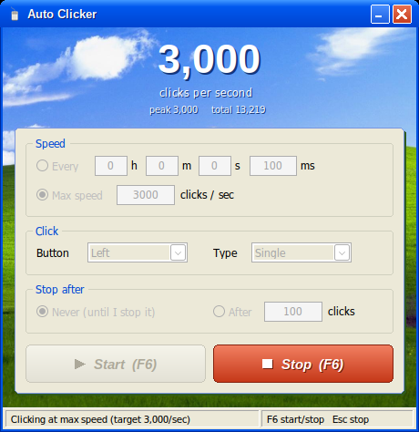

# Auto Clicker

A fast, lightweight auto clicker for Windows with a Windows XP look.



## Features

- **Max speed mode.** Set a target in clicks per second. The clicks are evenly spaced and timed with the high-precision counter, not Windows' 15.6 ms timer.
- **Interval mode.** Click every *h / m / s / ms*.
- **Live counter.** Shows current clicks per second, peak and total. It only counts clicks Windows actually accepted.
- **Hotkeys.** **F6** starts and stops from any window. **Esc** is an emergency stop and is only grabbed while clicking.
- **Click options.** Left, right or middle button, single or double click. Stop after a set number of clicks or run until stopped.
- **Small and self-contained.** A single ~1.6 MB `.exe` with no installer and no runtime dependencies.

## Download

Get `AutoClicker.exe` from the [Releases](../../releases) page and run it.

Windows SmartScreen may warn you the first time because the file isn't code-signed. Click **More info → Run anyway**. The full source is in this repo if you want to check it or build it yourself.

## Antivirus warnings

A few machine-learning scanners on VirusTotal (for example Trapmine) may flag `AutoClicker.exe`. That's a false positive. Those scanners guess from how a file looks, and an auto clicker looks suspicious to them: it simulates mouse clicks, registers global hotkeys, and isn't code-signed. Nothing is hidden: the full source is in `src/autoclicker.c`, and you can build the exe yourself (see **Building** below).

## How fast can it go?

The limit is your PC, not the app. Windows can only accept so many mouse events per second, and programs that watch every mouse event slow it down further. Examples are Discord, mouse software (Logitech G Hub, Razer Synapse) and game overlays (Steam, NVIDIA, AMD, Xbox Game Bar).

To find your limit:

1. Open `tools/cps-test.html` in your browser. It's a bare-bones click counter that won't freeze under an auto clicker.
2. Pick **Max speed**, start at 1,000 and raise the target.
3. Stop when the number stops going up, or when Windows starts **beeping**. Beeping means its input queue is overflowing and clicks are being dropped. Go back one step.

Some websites freeze at very high click rates. Their own code runs on every click and can't keep up, and the clicker can't fix that from outside the page. `tools/cps-test.html` is built to handle it.

## Building

The app is one C file using the plain Win32 API, with no frameworks.

**Windows:** install [Zig](https://ziglang.org/) (`winget install zig.zig`) or MinGW-w64, then run:

```bat
build.bat
```

**Linux / macOS (cross-compile):** install Zig (or `pip install ziglang`), then run:

```sh
./build.sh
```

Either way, the output is `build/AutoClicker.exe`.

To change the icon or background, replace `res/autoclickericon.png` or `res/autoclickerbg.jpg`, run `python tools/make_assets.py` (needs Pillow), then rebuild.

## Project layout

```
src/autoclicker.c        the whole app
res/                     icon, background, manifest, resource script
tools/cps-test.html      lightweight clicks-per-second test page
tools/make_assets.py     regenerates the .ico and .bmp from the source images
build.bat / build.sh     build scripts
```

## Use responsibly

Many online games ban auto clickers, and anti-cheat can detect them. Check the rules before using this in a game.

## Credits

Background: the Windows XP "Bliss" wallpaper, photo by Charles O'Rear. Windows XP and Bliss are trademarks or copyrights of Microsoft.
